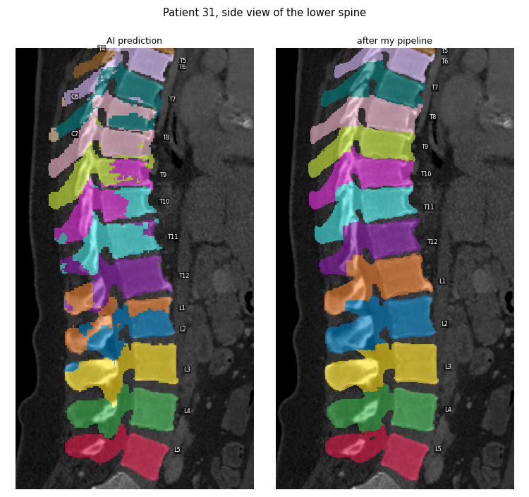
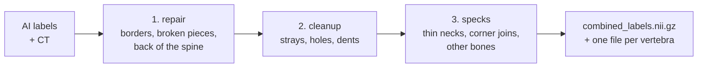
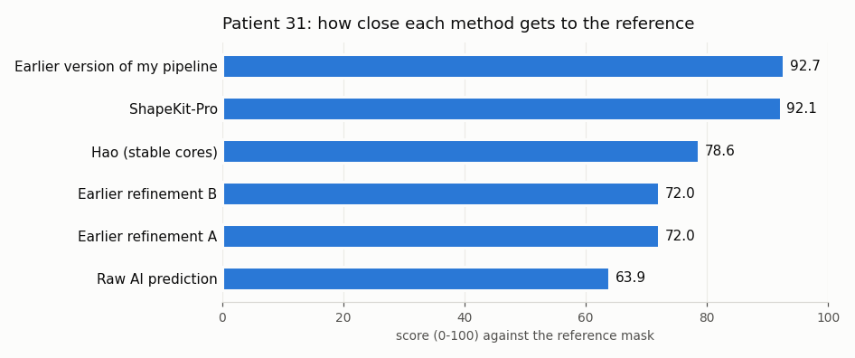

# Cleaning up AI vertebra labels on CT scans

This document describes the post-processing I built. It explains what the AI gets wrong, what the existing approaches do about it and where they fall short, how the pipeline works and why each part works, what I tried that didn't work, how I measure the results, and what still needs to be done.

<p align="center"></p>
<p align="center"><sub><b>Patient 31, lower spine.</b> Left: the AI's labels. Several vertebrae carry two colours, L1 has almost disappeared, and there are even C6/C7 labels in the middle of the thoracic spine. Right: the same scan after The fix.</sub></p>

---

## Contents
1. [The problem](#1-the-problem)
2. [Two existing approaches](#2-two-existing-approaches)
3. [The pipeline](#3-The-pipeline)
4. [Things that look wrong but aren't](#4-things-that-look-wrong-but-arent)
5. [What I tried that didn't work](#5-what-i-tried-that-didnt-work)
6. [Measuring the result: a scoring system](#6-measuring-the-result-a-scoring-system)
7. [Results](#7-results)
8. [Limitations](#8-limitations)
9. [Next steps](#9-next-steps)
10. [Running it](#10-running-it)
11. [References](#11-references)

---

## 1. The problem

The task, from the brief: run SuPreM's vertebra model on the AbdomenAtlas demo CTs (patients 6 and 31), look at the masks in ITK-SNAP, and write an automatic post-processing step, `postprocessing_vertebrae.py`, that removes as many of the errors as possible.

The model gives every voxel a number from 0 (background) to 24: **1 = L5 … 5 = L1, 6 = T12 … 17 = T1, 18 = C7 … 24 = C1.** The errors fall into a few kinds:

| Error | What it looks like |
|---|---|
| **Wrong borders** | one vertebra is painted half in its own colour and half in its neighbour's |
| **Wrong names** | a whole stretch is shifted by one level (on patient 31 the AI calls L1 "T12", T12 "T11", and so on) |
| **Broken vertebrae** | one vertebra is split into several separate pieces |
| **Specks** | small blobs of colour that look like they float next to a vertebra |
| **Wrong back parts** | the spinous processes slope down over the vertebra below, so the AI often gives them the lower vertebra's label |
| **Other bones** | skull or pelvis painted as a vertebra |

The two scans are also quite different: patient 31 has thin slices (0.7 mm), patient 6 has thick ones (2.5 mm). Thick slices turned out to matter a lot, as several sections below show.

---

## 2. Two existing approaches

Two clean-up methods had already been written for this task. I studied both closely, because between them they cover most of what a good solution needs.

### 2.1 Hao's method: stable cores

Hao Yu's method [1], now part of the ShapeKit toolkit [2], starts from a clever observation. If you shrink the spine mask step by step, touching vertebrae come apart into thick "cores", one per vertebral body. Those cores tell you where the bodies really are without trusting the AI's colours, and from them each body can grow back through bone to find its true borders.

From the front, the result looks clean:

<p align="center"></p>

From the side and the back it does not:

<table>
<tr>
<td align="center"><br><sub>Lower spine: patches of the wrong colour on the arches (cyan inside purple, orange on blue).</sub></td>
<td align="center"><br><sub>Upper spine: spinous tips with the wrong colour. This part lies outside the range Hao edits, so these are the AI's own mistakes, left in place.</sub></td>
</tr>
</table>

There are two reasons. The cores only describe the **bodies**. For the back of the spine, the method's own report says *"unreachable/ambiguous regions retain v2"*, so wherever it can't safely reach, it keeps the AI's original colours, mistakes included. And it only edits **L2 to T5**; every other vertebra stays exactly as the AI drew it.

### 2.2 ShapeKit-Pro: evidence from the CT

ShapeKit-Pro by Abhijit Das [3] takes the other route. It reads the anatomy out of the CT itself:
- discs show up as dark dips in brightness along the spine;
- the arch of each vertebra hangs on its body through the two pedicles;
- every editing step measures itself and undoes the change if things got worse.

It repairs the whole spine and handles the back of it properly, which is exactly where Hao's method stops.

What it leaves behind are **specks**:

<table>
<tr>
<td align="center"><br><sub>Small blobs of the wrong colour sitting on other vertebrae.</sub></td>
<td align="center"><br><sub>Close-up on patient 31: two blobs that look completely loose.</sub></td>
</tr>
</table>

The strange part is that the code *has* rules for removing loose pieces, and they never fired on these blobs. The reason took me a while to find.

---

## 3. The pipeline

I wanted a single script that keeps the strengths of both approaches and fixes what they miss. I worked through the same core ideas myself: reading the discs out of the CT, finding bodies without trusting the colours, and counting vertebrae from anatomical landmarks. In the end, the most complete implementation of the boundary repair was ShapeKit-Pro's, so step 1 adapts it. Steps 2 and 3 deal with what was still wrong afterwards.



One rule runs through all of it: **the CT decides.** Bone is bright (150 HU and above), discs and soft tissue are darker. A label only changes when the CT supports the change, and most steps undo themselves if they made things worse.

### 3.1 Step 1: repair

This is the heaviest part. It runs nine stages in order:

| Stage | What it does, and why it works |
|---|---|
| **Triage** | Every loose piece of a vertebra is judged by the CT. Tiny pieces and pieces that aren't bone are deleted, because the AI imagined them. Bone close to its vertebra is reconnected. Bone far away is set aside. |
| **Islands** | A piece wrapped mostly by another vertebra takes that vertebra's label. Vertebrae don't grow inside each other. |
| **Redraw borders** | Only for vertebrae that look wrong (broken, odd size, lost a lot of bone). It finds the discs as dips in CT brightness, then lets each vertebra grow through bone until they meet in the dark gaps (see the figure below). The arch is regrown from the pedicles. |
| **Polish** | A border that is suspiciously flat is moved onto the darkest line of the gap. Real joints are bumpy, so a flat border is usually an artificial cut. |
| **Smooth** | Smooths jagged surfaces by at most 1.5 mm, and undoes this for any vertebra that changes too much. |
| **Give bone back** | The bone set aside in triage goes back to the vertebra it is joined to *through bone*. |
| **Three views** | A voxel is relabelled only if the front, side and top views all agree. |
| **Mixed pieces** | A solid piece of bone carrying two labels gets one. |
| **Spinous processes** | Labels may only flow *downward* from where a spinous process starts, so a drooping tip keeps its own vertebra's label. |

The key idea is that **discs are visible in the CT**. Measuring brightness on disks laid across the spine, tilted with it so a curved spine doesn't blur the signal, every disc shows up as a dip:

<p align="center"></p>
<p align="center"><sub>Patient 31. Left: the spine's centre line (yellow) and the measuring disks (cyan). Right: brightness along the spine; every red line is a disc.</sub></p>

Not every disc gives a clean dip. That's why this stage only redraws stretches that already look wrong, and keeps the change only if a check of the whole spine (broken pieces, sizes, order) got better.

### 3.2 Step 2: cleanup

Three small fixes that the repair leaves to do:
- **Threads:** a bit hanging on its vertebra by a thread one voxel thin, but sitting on another vertebra, takes the other vertebra's label.
- **Strays:** small loose pieces mostly surrounded by another vertebra take that vertebra's label.
- **Holes and dents:** holes inside a vertebra and small dents in its surface are filled, but only where the CT shows bone, so the spinal canal is never filled, and never next to another vertebra, because that gap is the disc.

As a safety net, no vertebra may grow by more than 3 %, and if any vertebra ends up in more pieces than before, the whole cleanup is undone.

### 3.3 Step 3: specks, and why they survived everything else

**Why the specks survived.** Two voxels can count as "touching" in two ways: when they share a **face**, or already when they share a **corner**. A 3D viewer like ITK-SNAP only joins faces. Code that counts corners will call a blob "connected" when it touches its vertebra at a single corner, or hangs on a strand one voxel thin. On screen that blob looks loose; in the code it's part of the vertebra, so no speck rule ever looks at it.

<p align="center"></p>

On patient 31 the old code said every vertebra was one piece. Counted by faces there were **76 loose pieces**, plus **146 blobs on thin strands**. T11 alone was in 28 pieces.

**The fix: measure how thick the connection is.** Instead of asking *whether* a blob is connected, I ask *how thickly*:
1. Shrink each vertebra by 1 mm, then by 1.5 mm. Anything joined by a neck thinner than about 2–3 mm comes loose.
2. Treat pieces touching only at a corner or an edge as loose too.
3. A loose bit up to 150 mm³ (about a grain of rice) is a speck. If it sits on another vertebra, it takes that vertebra's label; if it sits on nothing, it is deleted.
4. Repeat until nothing changes.

The limits come from measurements, not guesses. Necks thinner than 3 mm only ever cut off small blobs (the biggest was 84 mm³). From 4 mm upwards real anatomy starts coming loose: transverse processes of the neck at around 1,000 mm³, the arch of C1 at 2,700 mm³.

<p align="center"></p>
<p align="center"><sub>T11 on patient 31: 28 pieces before this step, 1 after. Grey is the vertebra, red the loose bits.</sub></p>

**Thick slices.** On patient 6, with its 2.5 mm slices, a 1.5 mm shrink cannot reach the slice above or below. A blob joined only through a neighbouring slice was never cut. Shrinking up and down as well on every scan was far too aggressive: it ate real bone in the thin neck vertebrae. So this extra pass only runs on thick-slice scans, and it only removes pieces up to 50 mm³ that touch no other vertebra.

**Bones that aren't part of the vertebra at all.** After all this, C1 on patient 6 was still in two pieces. The second piece sat above and behind the C1 ring, on the back rim of the hole in the skull base. It is **skull**, which the AI had painted as C1:

<p align="center"></p>

Every earlier rule is built to *keep* bone, so none of them removed it. The question none of them asked was: **is this piece joined to its vertebra through bone?** So the last rule draws lines across the gap between a loose piece and its vertebra and reads the CT along them. If no line stays at bone level all the way across, they are two separate bones, and the piece is deleted (up to 2 cm³, and only if it touches no other vertebra). On patient 6 this removed exactly that skull piece. On every other output I tested, it fired once more: on the same skull piece in the raw AI prediction.

---

## 4. Things that look wrong but aren't

Not every odd shape in a 3D view is an error, and "fixing" these would make the labels worse.

### 4.1 A dot that is really a thin tip

On patient 6 I kept seeing a small magenta dot sitting in a notch of the next vertebra. With ITK-SNAP's **3D Gaussian smoothing** turned off, it is clearly attached:

<table>
<tr>
<td align="center"><br><sub>Smoothing on: looks like a floating dot.</sub></td>
<td align="center"><br><sub>Smoothing off: the tip of T10, attached.</sub></td>
</tr>
</table>

It is a thin tip of T10's back part resting on T11. The CT shows solid bone there (about 440 HU), and it is one piece with T10. On 2.5 mm slices the tip is only one or two slices thick, and the viewer's smoothing blurs that thin link away. Giving it to T11 would be wrong: the back parts of a vertebra belong to the vertebra they grow from.

<p align="center"></p>

### 4.2 C6 "growing into" C5

<p align="center"></p>

At first glance C6 (blue) pushes a tongue up into C5 (grey). I think this is real bone. In the neck, the top of each vertebral body from C3 to C7 has raised lips on both sides, the **uncinate processes**, which hook upward beside the vertebra above. A piece of C6 reaching up next to C5 is what normal anatomy looks like, and every voxel the pipeline adds has to be bone on the CT. I still want to confirm it slice by slice.

---

## 5. What I tried that didn't work

### 5.1 Counting vertebrae from a brightness curve

One idea was to walk up the spine slice by slice, measure how much bone there is in the front part, cut at the dips (the discs) and count the pieces, both from the bottom and from the top.

On patient 31 this works well: 22 clean segments from L5 up to C3.

<p align="center"></p>

On patient 6 it fails. With thick slices the discs in the middle of the thoracic spine no longer show up as dips, so two segments each swallow two or three vertebrae, and the count from the bottom runs out at "T4" while the scan reaches the neck.

<p align="center"></p>

Two lessons came out of this. Flat slices blur the discs wherever the spine curves, and measuring *across* the spine instead (as in step 1) avoids that. And thick slices hide discs, which came back to bite me several more times.

### 5.2 Checking the names against the ribs and the sacrum

Nothing in the pipeline checks the vertebra **names**. If the AI calls every vertebra one level off, the repair produces beautiful vertebrae with the wrong names. So I built a check:
- the vertebra sitting on the sacrum must be L5;
- the lowest vertebra with ribs on both sides must be T12;
- the highest with ribs must be T1.

Its first version raised a false alarm on patient 6. With thick slices it lost track of several vertebrae, matched ribs to vertebrae by height only (on a curved spine, T12's rib sits at the height of L1), and took the whole pelvis for the sacrum:

<p align="center"></p>

After fixing that, by counting on the labels and assigning ribs by what they actually touch, it confirmed the names on both patients and still caught deliberately shifted names. In the end I removed it from the script, because it only ever *reported*. It can't safely rename anything: about one person in ten has unusual anatomy (11 or 13 rib pairs, an L5 fused into the sacrum), and there an automatic rename would turn correct labels into wrong ones. It is a good candidate for a separate validation tool.

### 5.3 Smaller dead ends
- **Shrinking up and down on every scan** to catch the thick-slice specks deleted 3 cm³ of real bone in the neck, so it became the narrow thick-slice rule in 3.3.
- **Replacing the `cc3d` library with scipy** gives the same pieces but numbers them in a different order, and that order changes the repair's results slightly, so `cc3d` stays.
- **A second, independent pipeline** run alongside as a second opinion never influenced the labels, so it was dropped.

---

## 6. Measuring the result: a scoring system

Looking at 3D renders is how I found most problems, but it can't tell whether one version is better than another. So I made a reference mask for both patients (`Final02/`) and wrote `score_vertebrae.py`, which compares any prediction against it, vertebra by vertebra:

| Measure | Question it answers | Best |
|---|---|---|
| **Dice** | How much does the predicted vertebra overlap the reference? | 1.0 |
| **HD95** | How far off is the surface, in mm (ignoring the worst 5 %)? | 0 mm |
| **Naming** | Does most of the vertebra carry the right label? | yes |
| **Extra pieces** | Are there loose bits the reference doesn't have? | 0 |

They are combined into one number:

**score = 100 × (0.5 × mean Dice + 0.2 × naming + 0.2 × surface + 0.1 × clean)**

where *surface* is 1 − HD95 / 10 mm per vertebra (10 mm or worse counts as 0), and *clean* is the share of vertebrae without extra pieces.

Dice alone isn't enough. One added speck barely moves it (1.0 → 0.9998), and a swapped name hurts it only indirectly. I checked the score on artificial cases:

| Test case                  | Score |
| ----------------------------| -------|
| identical to the reference | 100   |
| shifted by 2 mm            | 91    |
| one speck added            | 96.7  |
| one vertebra missing       | 66.7  |
| two names swapped          | 40    |

---

## 7. Results

<p align="center"></p>

| Patient 31 | Score | Mean Dice | Worst vertebra | HD95 (mm) | Naming | Clean |
|---|---|---|---|---|---|---|
| Raw AI prediction | 63.9 | 0.761 | L1, 0.15 | 10.7 | 0.79 | 0.08 |
| Earlier refinement A | 72.0 | 0.809 | T11 missing | 6.9 | 0.88 | 0.25 |
| Earlier refinement B | 72.0 | 0.876 | T7, 0.69 | 8.5 | 1.00 | 0.04 |
| Hao | 78.6 | 0.919 | T8, 0.80 | 6.0 | 1.00 | 0.17 |
| ShapeKit-Pro | 92.1 | 0.990 | C7, 0.97 | 0.4 | 1.00 | 0.33 |
| Earlier version of this pipeline | 92.7 | 0.996 | C7, 0.98 | 0.03 | 1.00 | 0.29 |

The table shows three things:
- **The raw AI's naming problem is real.** It names T9 to L1 one level off on patient 31, which is why its L1 Dice is only 0.15.
- **Hao's method fixes the bodies but stops short.** Its scores are held back by the stretches and back parts it doesn't touch.
- **ShapeKit-Pro's shapes are already very close (Dice 0.99), but only a third of its vertebrae are clean.** The rest is specks, which is exactly what step 3 removes.

What The pipeline changes, per patient:

| | Patient 31 (0.7 mm slices) | Patient 6 (2.5 mm slices) |
|---|---|---|
| Problems found by the spine check (broken, size, order) | 22 → 0 | 11 → 0 |
| Specks relabelled / deleted | 30 / 215 | 70 / 91 (one of them skull) |
| Vertebrae in more than one piece | 18 → **0** | 13 → **0** |
| Volume changed by the speck step | 2.8 of 897 cm³ (0.3 %) | 2.5 of 704 cm³ (0.4 %) |

<table>
<tr>
<td align="center"><br><sub>Front</sub></td>
<td align="center"><br><sub>Back: clean arches and spinous processes</sub></td>
</tr>
</table>

**A caveat on the reference.** The reference mask currently *is* The pipeline's output, so the own result scores 100 by definition, and that number proves nothing. For now the scores only show how close other methods get to mine. Section 9 describes how to turn this into an independent benchmark.

---

## 8. Limitations

- **The speck step deletes bone, and that could be wrong on another patient.** Shrinking a vertebra by 1–1.5 mm is how the step finds thin necks, but on a patient with very thin bone (osteoporosis, a fracture, a child's spine, an unusual process) the same shrink could cut off a piece of real vertebra, which would then be relabelled or deleted. The "no bone across the gap" rule could misjudge a real fragment whose connection is too thin to show up as bone on the CT. On patients 6 and 31 I saw no sign of this: the speck step changes well under 1 % of the spine volume, and on patient 31 every vertebra keeps at least 98 % of its shape. Two patients are not enough, though, and this needs aggressive testing on many more scans.
- **Only two patients so far,** with one thin-slice and one thick-slice scan. Every limit in the speck step was measured on these two.
- **The names are not checked.** If the AI shifts a whole stretch by one level and the repair doesn't catch it, the output keeps the wrong names (see 5.2).

---

## 9. Next steps

1. **Rigorous testing on the remaining ~300 CT scans of the dataset.** Above all, this should check that the speck step never cuts real bone on thin, fractured or unusual vertebrae, and that the measured limits (3 mm necks, 150 mm³ specks, 50 mm³ thick-slice floaters, 2 cm³ separate bones) still hold.
2. **Make the reference independent.** Correct `Final02` by hand in ITK-SNAP wherever I disagree with the pipeline (the C6/C5 spot first), and add scans that come with expert labels, such as TotalSegmentator and VerSe.
3. **Bring back the name check as a separate tool** that flags suspicious names for a person to look at, without changing anything.

---

## 10. Running it

```bash
cd direct_inference
python postprocessing_vertebrae_compact.py --pred_dir ../AbdomenAtlasDemoPredict \
    --ct_root ../AbdomenAtlasDemo --out_dir ../Final --case BDMAP_00000031

python score_vertebrae.py --ideal ../Final02 --pred "raw AI=../AbdomenAtlasDemoPredict" \
    --pred "ShapeKit-Pro=../Refined_Pro" --out_dir ../scores
```

The pipeline writes `combined_labels.nii.gz` and one file per vertebra in `segmentations/`. Add `--no_specks` to skip step 3. A walk through the code is in `code_explainer.md`.

---

## 11. CREDITS


1. H. Yu. *Stable-core, two-scale geodesic correction of L2–T5* (the `shapekit_hao` backend of ShapeKit). [docs](https://github.com/BodyMaps/ShapeKit/blob/main/docs/VERTEBRAE_HAO.md), [pull request #16](https://github.com/BodyMaps/ShapeKit/pull/16)
2. J. Liu, D. He, W. Li, N. Wang, A. L. Yuille, Z. Zhou. *ShapeKit.* International Workshop on Shape in Medical Imaging, pp. 44–58, Springer, 2025. Code: [github.com/BodyMaps/ShapeKit](https://github.com/BodyMaps/ShapeKit)
3. A. Das. *ShapeKit-Pro: evidence-edited, anatomy-audited post-processing for vertebra segmentations.* [github.com/aj-das-research/jhu-bodymaps-warmup](https://github.com/aj-das-research/jhu-bodymaps-warmup)

