# Cleaning up AI vertebra labels on CT scans

*What I started with, what was wrong with it, what I built, and what I'm doing next.*

---

## TL;DR

| | |
|---|---|
| **The problem** | The AI (SuPreM) colours every vertebra in a CT scan, but leaves loose specks, wrong colours on the back of the spine, broken pieces and holes. |
| **My first try** | Cut the spine at the discs (dark dips in a bone-per-slice curve) and count the "drums". Great on thin slices, but it fell apart on thick slices and curved spines. |
| **What existed** | Two clean-up approaches: **ShapeKit-Pro** and the **Hao pipeline**. Each fixed some things and broke or missed others. |
| **What I built** | **One script** (`direct_inference/postprocessing_vertebrae.py`) that runs Pro, polishes the result, **removes the specks Pro left behind**, and then **checks the vertebra names against the ribs and sacrum**. |
| **Main fixes of mine** | 1. Specks that *looked* loose but were hidden-connected → removed. 2. Same thing on thick-slice scans. 3. A name checker that gave false alarms → rewritten and tested. 4. Four scripts merged into one, proven to give identical output. |
| **Scoring** | An **ideal mask** (`Final02`) plus a **scoring script** (Dice, surface distance, naming, specks → one 0–100 score) that rates any prediction against it. |

---

## 1. Where I started

### The task
From the brief (`direct_inference/vertebrae.md`): run SuPreM's vertebra model on the AbdomenAtlas demo CTs (patients **6** and **31**), look at the masks in ITK-SNAP ("you will see many errors"), and **design an automatic post-processing** that removes as many errors as possible, in one file: `postprocessing_vertebrae.py`.

### The AI: SuPreM
SuPreM is a pre-trained 3D segmentation model. Given a CT scan, its vertebra model paints each vertebra in its own colour (label), from **L5 (1)** up to **C1 (24)**. It's good, but not clean enough to use as is.

### Two existing clean-up approaches

| | **ShapeKit-Pro** | **Hao pipeline** |
|---|---|---|
| Who | Abhijit Das (credited in the code) | Hao Yu |
| Idea | Redraw borders using the CT itself: discs show up as **dark dips** between vertebrae; every step undoes itself if it doesn't improve things | Find the vertebral **bodies** as stable "cores" (shrink the mask until the bodies separate), without trusting the AI's colours, then let each core **grow through bone** to decide the borders ("stable cores + geodesic consensus") |
| What it edits | the whole spine | **only L2–T5**; every other vertebra is locked exactly as the AI drew it |
| Speed (patient 31) | ~11 min | ~6 min |
| Output | `Refined_Pro/` | `Refined_Hao/` (with its own `report.json`, `qa/` and `run_manifest.json`) |
| Code | [aj-das-research/jhu-bodymaps-warmup](https://github.com/aj-das-research/jhu-bodymaps-warmup) | the `shapekit_hao` backend in [BodyMaps/ShapeKit](https://github.com/BodyMaps/ShapeKit): [engine](https://github.com/BodyMaps/ShapeKit/blob/main/utils/vertebrae_hao_engine.py), [docs](https://github.com/BodyMaps/ShapeKit/blob/main/docs/VERTEBRAE_HAO.md), [pull request #16](https://github.com/BodyMaps/ShapeKit/pull/16) |

---

## 2. My first attempt: cutting the spine at the discs ("drums")

Before working with Pro and Hao, I tried my own approach.

### The idea
A vertebral body is bright, solid bone. The disc between two bodies is darker and softer. So if I walk up the spine **slice by slice, from the feet to the head**, and measure how much bone there is in the **front part** of the spine (the bodies), I should get a curve that **dips at every disc**. Cut at the dips, and each piece in between is one vertebral body, a "drum". Then:

1. **Count the drums** from the bottom (L5 upwards) **and** from the top (C1/C2 downwards), and check that both counts agree (`find_discs.py`).
2. **Use the drums to fix the AI's labels** (`fix_vertebrae.py`):
   - remove floating blobs;
   - split drums that are too tall, where the AI's colour changes inside them;
   - name the drums by trying every possible naming and scoring each one. The rules: names go up by exactly one per drum; a repeated name is only OK if the two drums together are one normal height; a skipped name is only OK if the drum is tall enough to hold the missing one; never more than 2 away from what the AI said; agreeing with the AI is cheaper;
   - give the back parts (arches) the name of the drum they're attached to through the pedicle;
   - sanity-check the sizes (L > T > C) and how much was changed.

### How it went
On **patient 31** (thin 0.7 mm slices) it worked really well: clean dips at every disc and **22 drums from L5 all the way up to C3**:

<p align="center">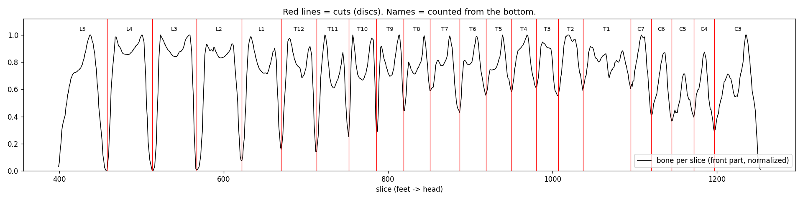</p>

On **patient 6** (thick 2.5 mm slices) it broke. In the middle of the thoracic spine the discs **don't show up as dips** anymore, so the "T7" and "T6" drums each swallow **2–3 vertebrae**. Counting from the bottom then runs out at "**T4**", even though the scan goes all the way up into the neck:

<p align="center">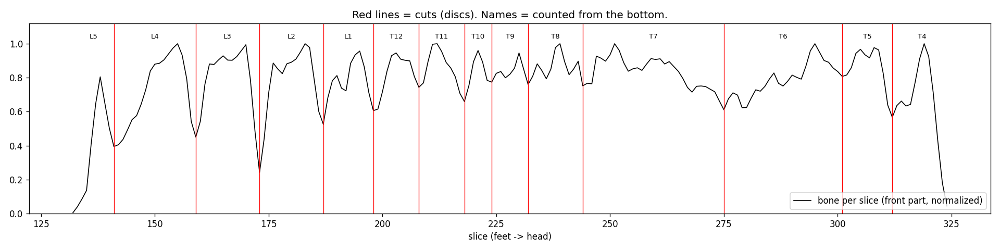</p>

### What I learned (and why I moved on)
- **Thick slices hide discs.** This turned out to be the theme of the whole project. The same problem came back later in the specks (4.3) and in the old name checker (4.4).
- **Slice-by-slice is too simple for a curved spine.** Where the spine bends, one flat slice cuts through two vertebrae at once and the dip gets blurred. Pro measures brightness on discs **perpendicular to the spine** instead, which is the grown-up version of the same idea.
- **Drums only cover the bodies.** The arches and spinous processes need their own handling, and Pro already does that properly (regrowing them from the pedicles).

So instead of rebuilding all of that myself, I took **Pro** (which already had the better version of my disc idea) as the base, and focused on what it still got wrong.

---

## 3. What was wrong with each

### 3.1 Hao: the front looks good, the back doesn't

From the front, Hao's result looks clean. Every vertebral body has one colour:

<p align="center">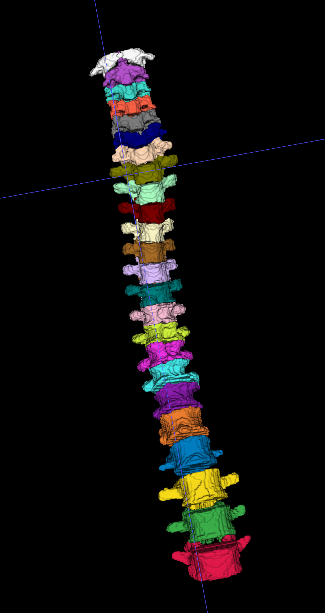</p>

But from the side and back, **parts of the arches and spinous processes are painted in the neighbour's colour**. You can see a vertebra's back part in the colour of the one above or below, and little tips of a different colour:

<table>
<tr>
<td align="center">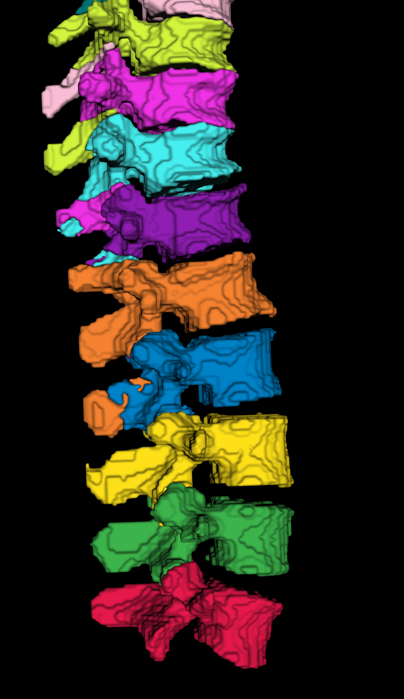<br><sub>Lower spine: wrong-coloured patches on the arches (e.g. cyan inside purple, orange on blue)</sub></td>
<td align="center">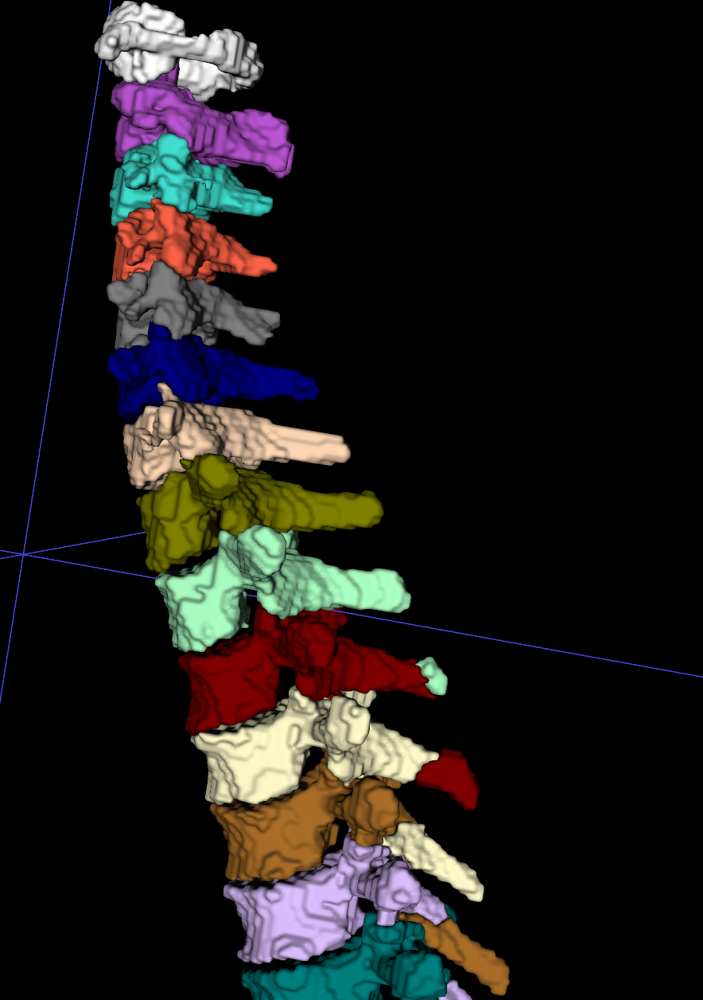<br><sub>Upper spine: spinous tips carrying the wrong colour (e.g. red tip on the cream vertebra). This is mostly above T5, where Hao doesn't edit, so these are the AI's own mistakes left in place.</sub></td>
</tr>
</table>

Why: Hao's method is built around the **bodies** (the cores), and its own report says so: *"No height-based posterior seeds. Unreachable/ambiguous regions retain v2."* In other words, wherever it can't safely reach the back of the spine, it **keeps the AI's original colours**, mistakes included. That part is hard anyway, because the spinous processes **droop down over the vertebra below**, so they easily get handed to the wrong owner. On top of that, Hao only edits **L2–T5**, so nothing above or below that range is touched. On patient 31 it changed 360,603 voxels, and every body core ended up with a single colour (purity 1.0).

### 3.2 ShapeKit-Pro: the shapes are good, but specks are left

Pro fixes the borders and the back of the spine well (its audit went from 21 broken vertebrae to 0 on patient 31), **but it leaves small blobs of colour**:

<table>
<tr>
<td align="center">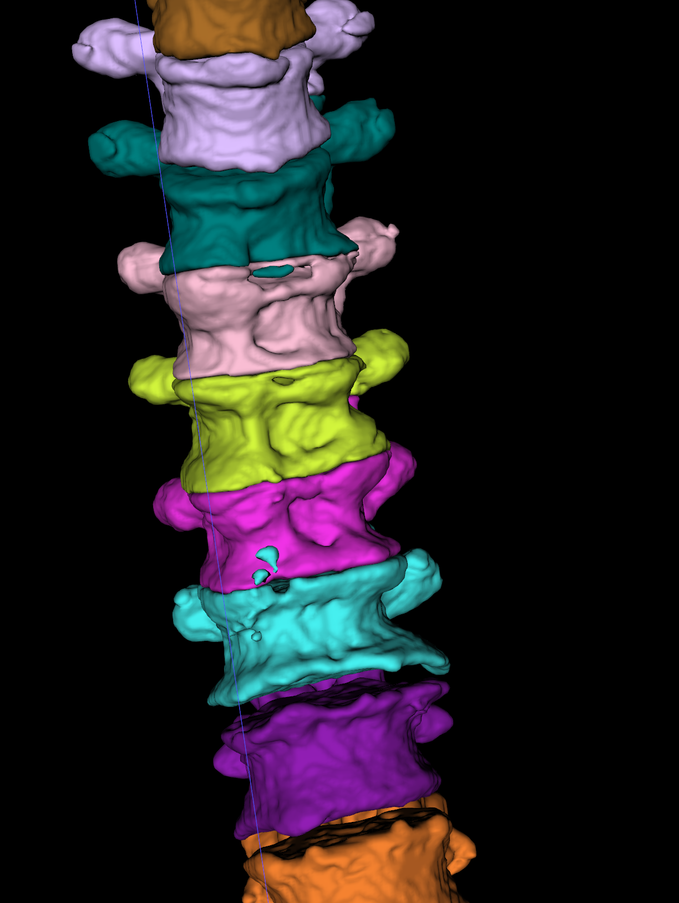<br><sub>Pro: small cyan/teal specks sitting on other vertebrae</sub></td>
<td align="center">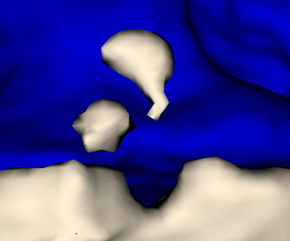<br><sub>Close-up: two blobs that look completely loose</sub></td>
</tr>
</table>

**The weird part:** Pro (and the cleanup after it) has rules to remove loose specks. So why didn't they fire?

I checked and found that **the code thought these blobs were connected**. It used "26-neighbour" connectivity, where two voxels count as touching if they share even **one corner**. A 3D viewer only joins voxels that share a **face**. So a blob touching its vertebra at a single corner, or hanging off it by a 1-voxel strand, **looks separate on screen but is "connected" to the code**, and the speck rules never even looked at it.

<p align="center"></p>

How many were there? On patient 31, every vertebra was "one piece" according to the code, but counting face-only there were **76 loose pieces** (T11 alone was in 28 pieces), plus **146 blobs on thin strands**.

---

## 4. What I built on top

### 4.1 One pipeline, one command

Before, there were 3 steps across 4 files (`pro_postprocessing_vertebrae.py` → `finalize_vertebrae.py`, which uses `check_names.py` and `postprocessing_vertebrae.py`). I merged everything into **one file**:

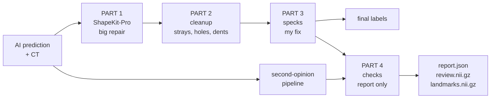

```bash
python postprocessing_vertebrae.py --pred_dir ../AbdomenAtlasDemoPredict \
    --ct_root ../AbdomenAtlasDemo --out_dir ../Final --case BDMAP_00000031
```

**How I made sure merging didn't break anything:** I ran the old 3-step chain and the new single file on the same patient, with my speck step switched off, and compared every output. Labels, review mask, landmarks, all 24 per-vertebra files, every report field and Pro's log were **identical, voxel for voxel**. Only then did I switch my new parts on.

### 4.2 My speck removal (PART 3)

The idea: **measure how thick the connection is**, not just whether it exists.

1. **Shrink each vertebra by 1 mm, then 1.5 mm.** Any strand or neck thinner than about 2–3 mm disappears, so a blob hanging on by it comes loose.
2. **Also treat corner-only and edge-only joins as loose.**
3. For every loose bit **smaller than 150 mm³** (roughly a grain of rice):
   - if it sits **on another vertebra** → it gets **that vertebra's colour**;
   - if it sits **on nothing** → it's **deleted**.
4. Repeat until nothing changes (it settles after 2 rounds).

**How I picked the limits:** I measured it. Necks under 3 mm only ever cut off small blobs (the biggest was 84 mm³). From 4 mm upwards, real anatomy starts coming loose: cervical transverse processes of about 1,000 mm³, and the C1 arch at 2,700 mm³. So "neck < 3 mm and < 150 mm³" catches the specks without touching real bone.

**Results:**

| Patient 31 | Before | After |
|---|---|---|
| Loose pieces (face-only) | 76 | **0** |
| Blobs on thin necks (< 3 mm) | 146 | **0** |
| Vertebrae in more than one piece | 18 | **0** |
| Volume changed | — | 2.8 cm³ of 897 cm³ (**0.3 %**) |
| Shape kept (Dice per vertebra) | — | ≥ 0.993, except C5 (0.983) |
| Real processes kept (the ones that only come loose at 4 mm) | 4 | 4 |

<table>
<tr>
<td align="center"><br><b>Pro</b>: specks</td>
<td align="center">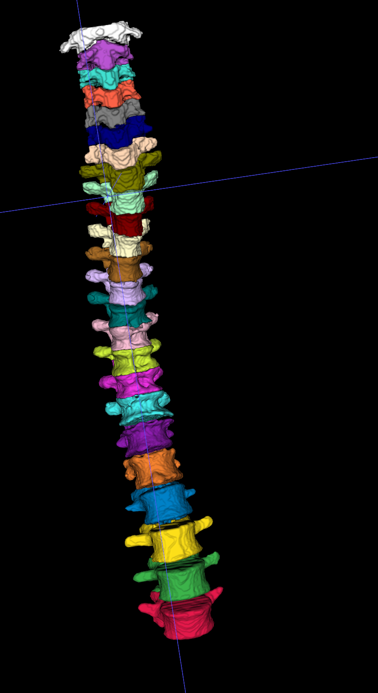<br><b>Mine</b>: front, clean</td>
<td align="center">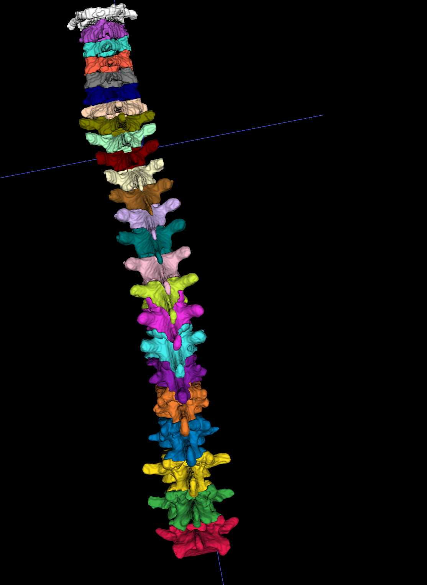<br><b>Mine</b>: back, clean arches and spinous processes</td>
</tr>
</table>

I also stress-tested it on four other outputs of the same patient (Pro, Hao and two older refinements). It removed every thin-neck speck in all of them.

### 4.3 Thick-slice scans (patient 6)

On patient 6 I still saw **one magenta dot**:

<p align="center">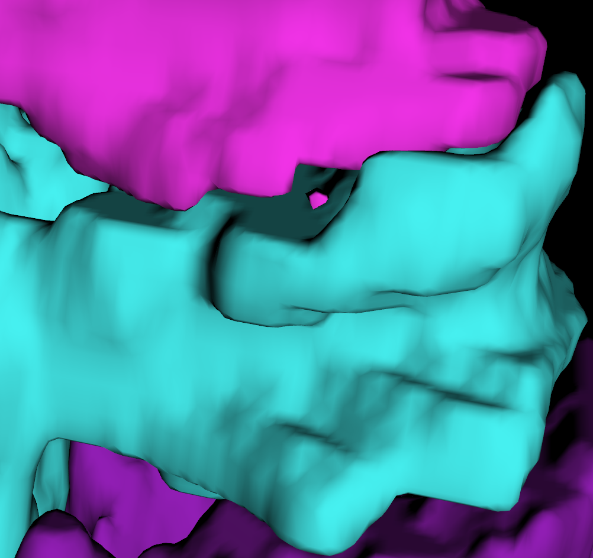</p>

Looking for the cause, I found a real gap in my speck rule. Patient 6's slices are **2.5 mm thick** (patient 31's are 0.7 mm), and a 1–1.5 mm shrink **can't reach the next slice**. So a blob joined only through the slice above or below was never cut. That was an assumption in my own rule.

The obvious fix (always shrink up and down too) was **too aggressive**. It deleted 3 cm³, mostly real bone in the thin neck vertebrae, and created new loose pieces. So I made it narrower: **only on thick-slice scans**, delete pieces **≤ 50 mm³** that are joined through a single slice **and touch no other vertebra**.

- It removed 8 small floaters like that (e.g. an 8-voxel bit of T12).
- Only 233 mm³ changed in total; every vertebra kept ≥ 99.8 % of its shape.
- Patient 31 is **provably unchanged**: with thin slices this extra step never runs.

**But the magenta dot was still there.** It turned out not to be one of those floaters at all:

#### A "speck" that wasn't one: the viewer's smoothing
The dot sits in a notch of the cyan vertebra. In my colour table magenta = **T10** and cyan = **T11**:

<table>
<tr>
<td align="center">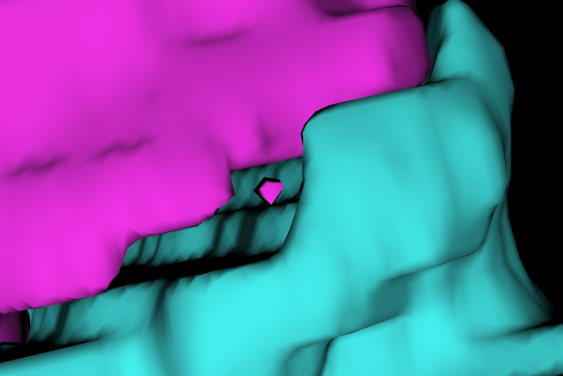<br><sub>ITK-SNAP with <b>3D Gaussian smoothing ON</b>: looks like a floating dot</sub></td>
<td align="center">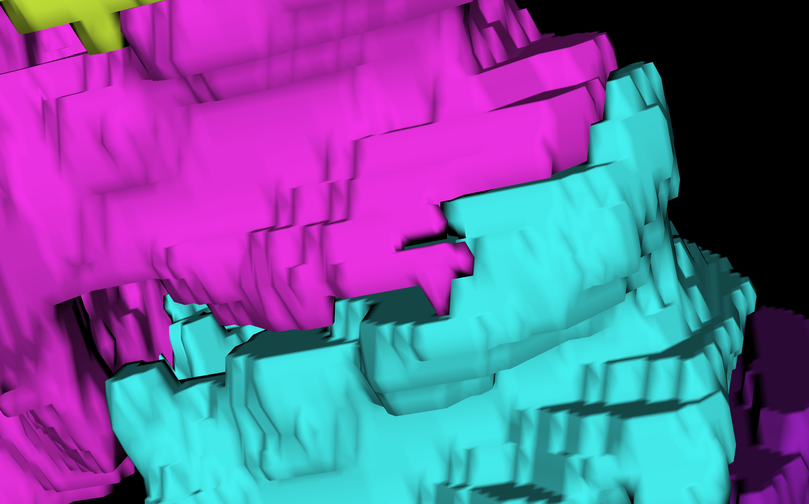<br><sub>Same spot, <b>smoothing OFF</b>: it's a tip of T10, attached</sub></td>
</tr>
</table>

This time the code wasn't wrong. When I checked the CT at the most likely spot (about voxel 255, 123, slice 212):
- it's a **thin tip of T10's back part**. The back of a vertebra slopes **down**, so this tip rests right on T11;
- the CT there is **about 440 HU**, which is solid bone, so it's real;
- it is **still part of T10** (one connected piece), so the speck step correctly leaves it alone.

<p align="center">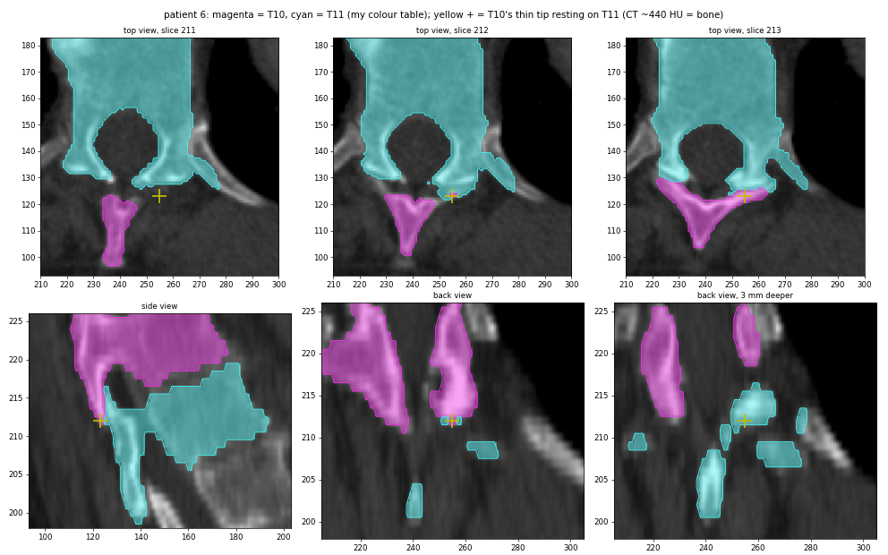</p>

So why did it look loose? On patient 6's 2.5 mm slices the tip is only **1–2 slices thick**. ITK-SNAP's **3D Gaussian smoothing** blurs the mask before drawing the surface, and a link that thin gets smoothed away, so the tip shows up as a separate blob. With smoothing turned **off**, it's clearly joined to T10.

**Lesson:** not every dot in a 3D render is an error. Before "fixing" one, check the CT and the raw (unsmoothed) mask. Recolouring this tip as T11 would actually make the label **wrong**: the back parts of a vertebra belong to the vertebra they start from, and keeping it that way is one of the things Pro was built to do.

### 4.4 The rib and sacrum name check (PART 4b)

#### What it's for
Pro and the cleanup fix **shapes and borders**, but they **trust the AI on names**. The classic AI mistake is calling every vertebra **one level off** (the real L5 labelled L4, and so on), especially on abdominal CTs where you can't count from the top. In that case Pro produces clean, beautiful vertebrae **with the wrong names**, and its audit still says "all fine".

The name check is the only part that looks at **anatomy outside the spine labels**:
- the vertebra sitting **on the sacrum** must be **L5**;
- the lowest vertebra with **ribs on both sides** must be **T12**;
- the highest one with ribs must be **T1** (used only if all 12 rib levels were found).

It counts from these landmarks and compares with the AI's names.

#### It doesn't change labels, on purpose
It **only reports**: a verdict in `report.json`, and the vertebrae with suspicious names marked in `review.nii.gz`. About 1 in 10 people have unusual anatomy (11 or 13 rib pairs, L5 fused into the sacrum, a sixth lumbar vertebra). For them the rib/sacrum rule itself is wrong, and an automatic rename would silently turn correct labels into wrong ones. As a flag, the worst case is that someone double-checks a scan that was fine.

#### The bug I found
On patient 6, the old checker said **NEEDS_BOUNDARY_FIX** ("L4 should be L5", "T2 should be T3"…). I checked the CT myself, and **the labels were right; the checker was wrong**:

1. **It lost vertebrae.** It found only 16 of 24 bodies on these thick slices (missing L5, T5, T1, C7–C3, C1), and counted names on what it found. So every missing body shifted all the names after it.
2. **It matched ribs to vertebrae by height only.** On a curved spine, T12's rib sits at the height of L1, so it said "L1 has ribs".
3. **Its "sacrum" was the whole pelvis** (221 mm wide), sitting **on top of L5**, because it searched under the lowest body it *found*, which was L4.
4. **False alarms:** a "second L4 body" that was really L4's **arch**, and "T5/T6 mixed" because the thin disc between them doesn't show on 2.5 mm slices.

<p align="center">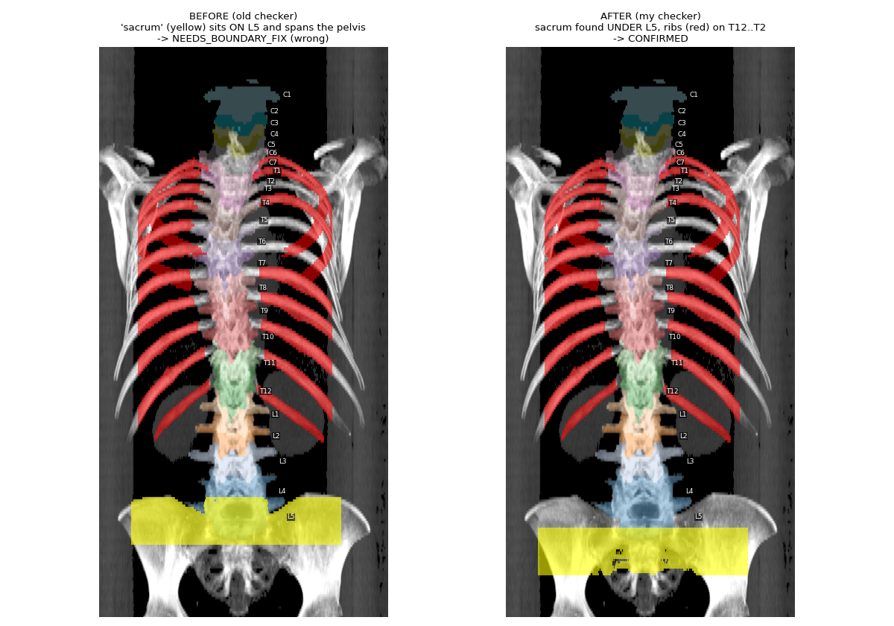</p>
<p align="center">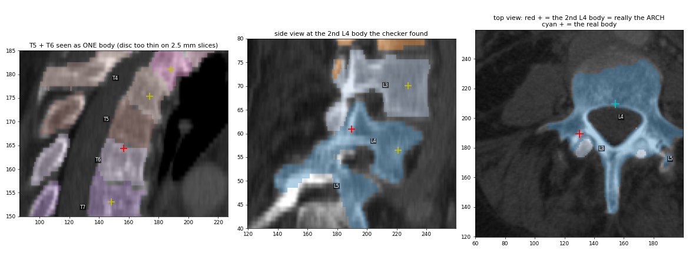</p>

#### What I changed
- **Count names on the labelled vertebrae**, not on the bodies it manages to find, so a body that's hard to see can't shift the count.
- **Each rib goes to the vertebra it actually touches** (closest point in 3D), not to whichever one is at the same height.
- **Look for the sacrum under the lowest labelled vertebra.**
- **Only use "highest rib = T1" if 12 rib levels are found.** The first rib is often missed, and it was missed on **both** patients, so the old rule was only right on patient 31 by luck.
- **Ignore false alarms:** cores on an arch, two neighbours merged across an unseen disc, and skull-base bone next to C1/C2 that looks like a rib.

#### Tests: it still catches real errors
I fed it the real labels and two kinds of deliberately broken labels, on both patients:

| Test | Patient 31 | Patient 6 |
|---|---|---|
| Real labels | ✅ CONFIRMED | ✅ CONFIRMED (was NEEDS_BOUNDARY_FIX) |
| Every name shifted by one level | ✅ WRONG_NAMES | ✅ WRONG_NAMES |
| Top 40 % of L3 relabelled as L2 | ✅ NEEDS_BOUNDARY_FIX | ✅ NEEDS_BOUNDARY_FIX |

---

## 5. Side by side

| | Hao | ShapeKit-Pro | **Mine** |
|---|---|---|---|
| Vertebral bodies (front) | ✅ clean | ✅ clean | ✅ clean |
| Arches / spinous processes (back) | ❌ neighbour's colour | ✅ | ✅ |
| Loose specks | — | ❌ hidden-connected blobs | ✅ removed (76 → 0) |
| Thick-slice scans | — | ❌ | ✅ |
| Range edited | L2–T5 only | whole spine | whole spine |
| Name check (ribs/sacrum) | — | — | ✅ fixed, tested, report only |
| One command | — | — | ✅ |

| | Patient 31 (0.7 mm slices) | Patient 6 (2.5 mm slices) |
|---|---|---|
| Run time | ~16 min | ~2.5 min |
| Pro audit (broken / order / size) | 21 / 0 / 1 → 0 / 0 / 0 | 10 / 1 / 0 → 0 / 0 / 0 |
| Specks fixed | 30 recoloured, 215 deleted | 70 recoloured, 90 deleted |
| Vertebrae in > 1 piece | 18 → **0** | 13 → **1** (C1, see limits) |
| Name check | CONFIRMED | CONFIRMED |
| Pro vs second-opinion pipeline (bodies L2–T5) | agree on 5, differ on T11–T7 | agree on all 10 |

---

## 6. C6 "growing into" C5: I think this is real bone

<p align="center">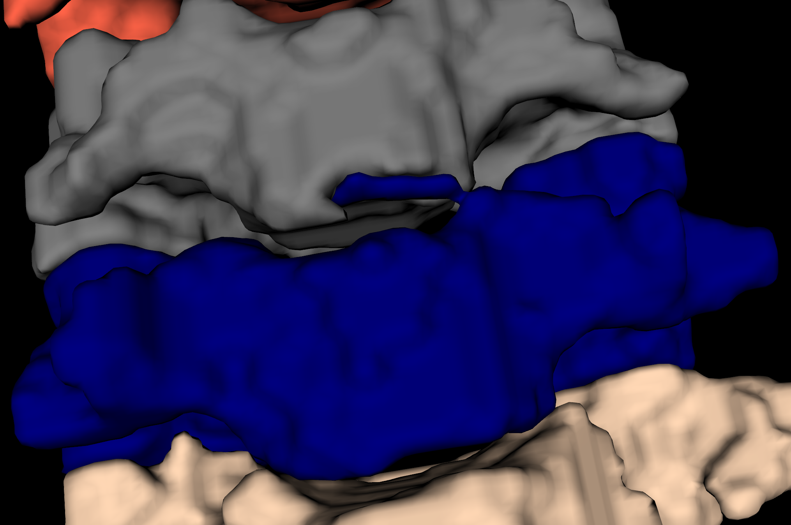</p>

Here C6 (blue) seems to push a tongue up into C5 (grey). At first it looks like a labelling error, but **I think this is real bone, not a mistake**:

- In the neck (C3–C7), the top of each vertebral body has raised lips on both sides, the **uncinate processes**. They hook **upwards** beside the vertebra above. So a bit of C6 reaching up next to C5 is exactly what normal anatomy looks like.
- My pipeline only adds voxels where the CT shows bone (hole/dent filling and Pro's reconnections are all bone-gated), so this tongue is bone on the scan, not something invented.

I still want to confirm it slice by slice on the CT, but for now I'm treating it as anatomy rather than an error.

---

## 7. How the code works (simple version)

Everything is in **`direct_inference/postprocessing_vertebrae.py`**. One rule runs through all of it: **only change something if the CT backs it up** (bone is bright, discs are darker), and **undo any step that doesn't make things better.**

| Part | What it does, in plain words |
|---|---|
| **1. ShapeKit-Pro** | **Sort loose bits:** tiny → delete; not bone → delete; bone near its vertebra → reconnect. **Islands:** a piece wrapped by another vertebra joins it. **Redraw suspicious borders at the discs:** walk up the spine, every dark dip is a disc; vertebrae "grow" through bone from their middles and meet in the gaps. **Arches:** regrown from the pedicles, the two bony bridges to their own body. **Straighten flat cuts** onto the darkest line. **Put set-aside bone back** with its right owner. **Check colours from 3 views**: recolour only if all agree. **Fix mixed pieces.** **Spinous processes:** colour may only flow downward. **Smooth** edges, fill holes. |
| **2. Cleanup** | Stray pieces sitting on another vertebra take its colour. Fill holes and small dents, but only where the CT shows bone (so the spinal canal is never filled). No vertebra may grow by more than 3 %. |
| **3. Specks (mine)** | Shrink each vertebra 1–1.5 mm. Anything that comes loose (plus corner-only joins) and is < 150 mm³ goes to the vertebra it sits on, or is deleted. On thick-slice scans, also small floaters joined through one slice. |
| **4a. Second opinion** | Runs a second, independent repair pipeline on the same scan and compares its bodies L2–T5 with ours. It uses Hao's "cores" idea plus rib/sacrum naming and a disc re-cut, but it is **not** Hao's original program; the code calls it `run_hao` / `--no_hao_check` for historical reasons. Disagreements are marked in `review.nii.gz` (value 1). |
| **4b. Name check (mine, rewritten)** | Sacrum → L5, lowest ribs → T12, (highest ribs → T1). Verdict CONFIRMED / WRONG_NAMES / NEEDS_BOUNDARY_FIX / UNSURE. Wrong names are marked in `review.nii.gz` (value 2). |

### Output files (`Final/<patient>/`)

| File | What it is |
|---|---|
| `combined_labels.nii.gz` | the cleaned labels, all vertebrae in one file |
| `segmentations/vertebrae_*.nii.gz` | the same, one file per vertebra |
| `review.nii.gz` | places to look at (1 = Pro and the second-opinion pipeline disagree, 2 = name doesn't match the anatomy) |
| `landmarks.nii.gz` | the ribs (coloured by their vertebra) and the sacrum (25) the checker found |
| `report.json` | every decision and number |
| `pro_qa.json` | ShapeKit-Pro's detailed log |

### Main settings I added (in `FIN_CFG`)

| Setting | Value | Meaning |
|---|---|---|
| `speck_neck_radii_mm` | 1.0, 1.5 | how far to shrink; necks thinner than ~2× this are cut |
| `speck_max_mm3` | 150 | loose bits up to this size count as specks |
| `speck_host_frac` | 0.5 | share of a speck's outside that must be another vertebra for it to take that colour |
| `speck_thick_max_mm3` | 50 | thick slices only: size limit for floaters joined through one slice |

Switches: `--no_specks` (old behaviour), `--no_hao_check` (skip the second pipeline, about 1 min faster).

---

## 8. Known limits (being honest)

- **C1 on patient 6** is still in 2 pieces. One is 243 mm³, above the 150 mm³ limit, so I left it on purpose since it could be real bone.
- **Unusual anatomy** (11 or 13 rib pairs, transitional vertebrae) can fool the name check. That's why it only reports.
- **Needs real CT values** (Hounsfield units). A converted 0–255 image won't work.
- **Needs `cc3d`** (`pip install connected-components-3d`). Pro relies on it, and I tested that scipy can't replace it without changing Pro's results.
- **Memory:** peaks around 8 GB on a long scan.
- **Viewing tip:** when checking results in ITK-SNAP, especially on thick-slice scans, turn **3D Gaussian smoothing off**. It can make thin, real bone (like spinous tips) look like loose specks.

---

## 9. Scoring system: measuring instead of eyeballing

I made an **ideal mask** (`Final02/`, for patients 6 and 31) that I treat as the "right answer". I then built a scoring script, `direct_inference/score_vertebrae.py`, that compares **any** prediction folder against it, vertebra by vertebra.

```bash
python score_vertebrae.py --ideal ../Final02 \
    --pred "raw AI=../AbdomenAtlasDemoPredict" --pred "Pro=../Refined_Pro" \
    --pred "Hao=../Refined_Hao" --out_dir ../scores
```

### What it measures (per vertebra)
| Metric | Meaning | Good value |
|---|---|---|
| **Dice** | how much the predicted vertebra overlaps the ideal one | 1.0 |
| **HD95** | how far off the surface is, in mm (95th percentile, ignores a few outliers) | 0 mm |
| **ASSD** | average surface distance, in mm | 0 mm |
| **Naming** | does most of the vertebra carry the right label? | yes |
| **Extra pieces** | loose bits compared with the ideal (specks / breaks) | 0 |

Plus **spine Dice**: all vertebrae as one mask, so it only checks the outline and ignores names.

### One overall score (0–100)
**SCORE = 100 × (0.5 × mean Dice + 0.2 × naming + 0.2 × surface + 0.1 × clean)**

- *surface* = 1 − HD95 / 10 mm, per vertebra (10 mm or worse gives 0);
- *clean* = the share of vertebrae with no extra pieces.

I added naming and cleanliness because **Dice alone misses them**. On my test masks, one added speck only moved Dice from 1.0 to 0.9998, and swapping two names is a disaster that Dice per label shows only indirectly.

I sanity-checked it on synthetic masks:

| Test | Score |
|---|---|
| identical | **100** |
| shifted 2 mm | 91 |
| one speck | 96.7 |
| one vertebra missing | 66.7 |
| two names swapped | 40 |

### Results (patient 31)
| Method | SCORE | mean Dice | worst vertebra | HD95 (mm) | naming | clean |
|---|---|---|---|---|---|---|
| raw AI | 63.9 | 0.761 | L1 0.15 | 10.7 | 0.79 | 0.08 |
| AbdomenAtlasDemoRefined | 72.0 | 0.809 | T11 0.00 (missing) | 6.9 | 0.88 | 0.25 |
| AbdomenAtlasDemoRefined1 | 72.0 | 0.876 | T7 0.69 | 8.5 | 1.00 | 0.04 |
| Hao | 78.6 | 0.919 | T8 0.80 | 6.0 | 1.00 | 0.17 |
| Pro | 92.1 | 0.990 | C7 0.97 | 0.4 | 1.00 | 0.33 |
| Final1 | 92.7 | 0.996 | C7 0.98 | 0.03 | 1.00 | 0.29 |

Patient 6: the raw AI scores **88.0** (mean Dice 0.946, but only 42 % of vertebrae clean).

**What this shows:**
- **The raw AI names T9–L1 one level off on patient 31.** L1 is labelled as T12, T12 as T11, and so on, which is why its L1 Dice is only 0.15. That's exactly the kind of error the rib/sacrum check is there to catch.
- **Pro's shapes are already very close (Dice 0.99), but only 33 % of its vertebrae are clean.** The specks are what's left, and that's the part I fixed.
- **Hao edits only L2–T5**, so everything else keeps the AI's mistakes.

**Honest caveat:** `Final02` is currently **identical to my pipeline's output** (`Final/`). So my own result scores 100 by definition, and that number proves nothing about my method. Right now the scores tell how close *other* methods get to mine. To make it a real benchmark, the next step is to **hand-correct `Final02`** in ITK-SNAP wherever I disagree with my pipeline (for example the C6/C5 spot, or the C1 piece). Every method, including mine, then gets scored against a truly independent answer. More cases would help too: AbdomenAtlas, or TotalSegmentator/VerSe, which come with expert vertebra labels.

---

## Credits
- **SuPreM**: the pre-trained segmentation model that produces the initial labels.
- **ShapeKit-Pro** (PART 1): written by **Abhijit Das**. [github.com/aj-das-research/jhu-bodymaps-warmup](https://github.com/aj-das-research/jhu-bodymaps-warmup)
- **Hao's pipeline** ("stable cores + geodesic consensus", output in `Refined_Hao/`) and the body-finding ("shrinking into cores") idea: **Hao Yu**. Published as the `shapekit_hao` backend of [BodyMaps/ShapeKit](https://github.com/BodyMaps/ShapeKit) ([docs](https://github.com/BodyMaps/ShapeKit/blob/main/docs/VERTEBRAE_HAO.md), [pull request #16](https://github.com/BodyMaps/ShapeKit/pull/16)).
- **ShapeKit** (the original toolkit): Liu et al., *ShapeKit*, Shape in Medical Imaging workshop 2025 (cited in the task brief).
- **My work:** the first disc/drum approach (`find_discs.py`, `fix_vertebrae.py`), merging everything into one tested script, the speck removal (incl. thick slices), the rewritten and tested rib/sacrum name check, the analysis in this document, and the upcoming scoring system.
