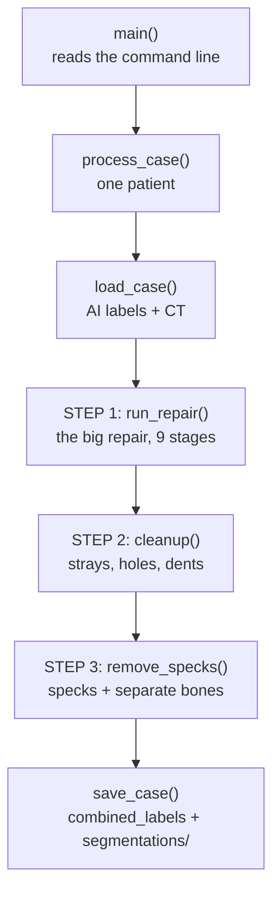
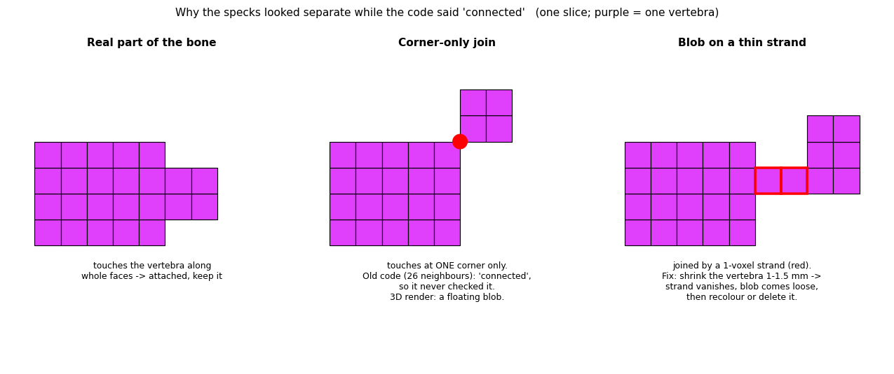
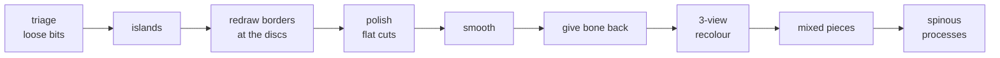
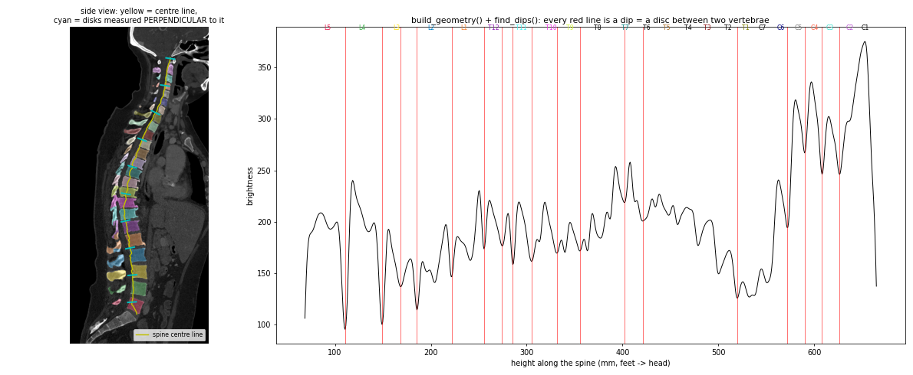
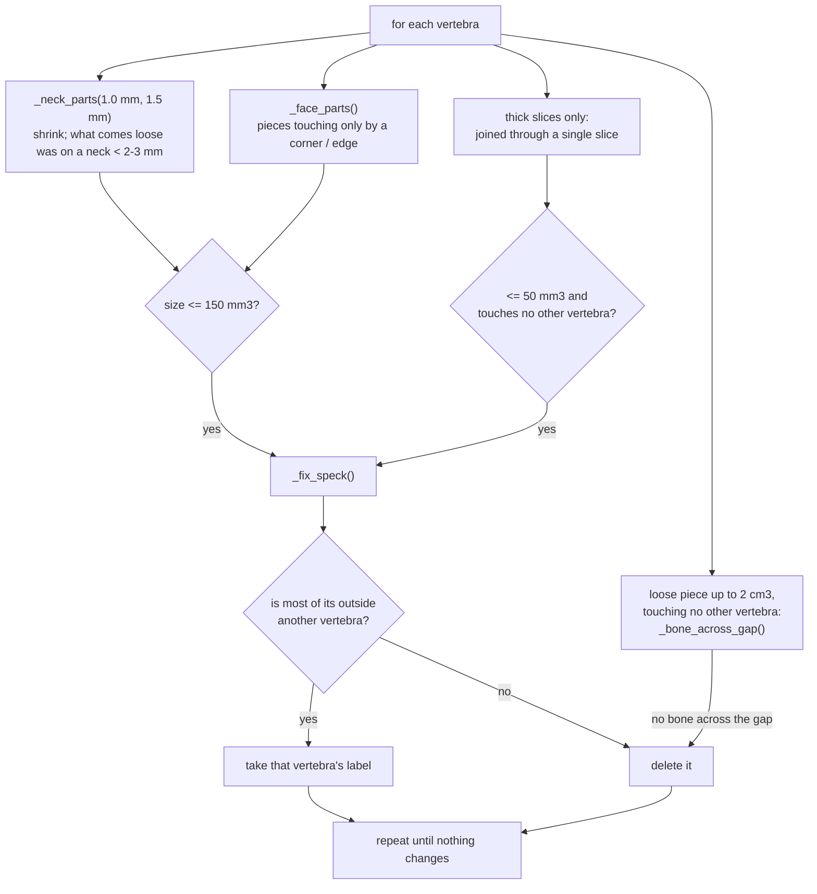
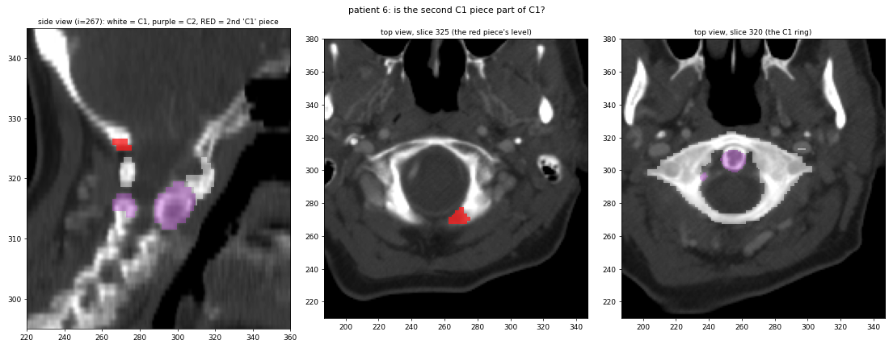
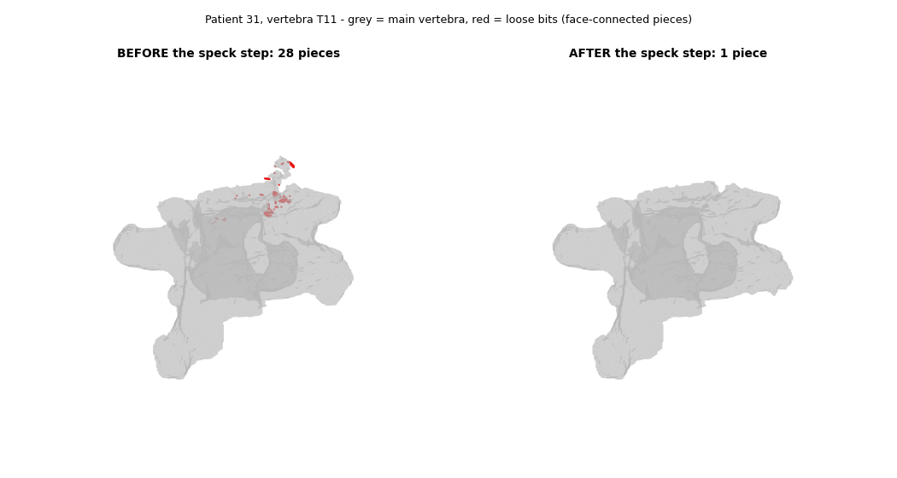

# How the post-processing script works

*A walk through `direct_inference/postprocessing_vertebrae.py` *


**The one rule behind everything:** *the CT decides.* Bone is bright (≥ 150 HU); discs and soft tissue are darker. A label only changes when the CT supports it, and most steps **measure themselves and undo the change** if things didn't get better.

---

## 1. The big picture



Three steps, all of which change labels, then save. Nothing else is written.

---

## 2. Map of the file

| Lines | What's there |
|---|---|
| 1–20 | imports, `log`, label names `NAMES` / `ID`, neighbour shapes `S26` / `S6` |
| 22–50 | **`CFG`**: every setting in one dict |
| 52–70 | small helpers `_boxes()`, `_face_pairs()`, `_bad()` |
| 72–150 | loading / saving, spine box, piece counting, `audit()` |
| 195–1537 | **step 1**: the 9 repair stages and their helpers |
| 1538–1676 | **step 2**: `cleanup()` and its three fixes |
| 1677–1792 | **step 3**: `remove_specks()` and its helpers |
| 1793–end | driver: `_spine_crop()`, `run_repair()`, `process_case()`, `main()` |

Every function has a short `##` comment right above it saying what it does.

---

## 3. Basics you need first

### 3.1 Labels
Every voxel holds a number: **0 = background, 1 = L5 … 24 = C1**, counting from the bottom up.

| 1–5 | 6–17 | 18–24 |
|---|---|---|
| L5, L4, L3, L2, L1 | T12, T11 … T1 | C7, C6 … C1 |

In code: `NAMES[1] == "L5"`, `ID["T12"] == 6`, and `TOP_DOWN` is the list from C1 down to L5.

### 3.2 Voxels and mm
A voxel isn't a cube: patient 31 is 0.91 × 0.91 × **0.7** mm, patient 6 is 0.78 × 0.78 × **2.5** mm. So the code measures in **mm** (`zooms` = voxel size), not in voxels. A "1.5 mm shrink" is a very different number of voxels on those two scans.

### 3.3 "Connected": 6 vs 26 neighbours
Two voxels can count as touching if they share a **face** (`S6`) or even just a **corner** (`S26`). That difference was the reason for the specks:

<p align="center"></p>

A 3D viewer only joins faces, so a corner-only join *looks* separate. Code that counts corners calls those blobs "connected" and never cleans them. Step 3 fixes that.

### 3.4 Four tools used everywhere
| Tool | Plain words | Used for |
|---|---|---|
| **erosion** (`binary_erosion`) | shave the surface: **shrink** the mask. Thin strands vanish first. | finding thin necks |
| **dilation** (`binary_dilation`) | grow the mask; used to look at a piece's **outside ring** ("what is it touching?") | deciding who a piece belongs to |
| **distance transform** (`distance_transform_edt`) | for every voxel, the distance in mm to the nearest edge / nearest other thing | gaps, thickness, "nearest part" |
| **connected components** (`ndimage.label`, `cc3d`) | split a mask into separate **pieces** | everywhere |

### 3.5 Cropping
The scans are 512 × 512 × up to 1,394 voxels, but the spine is a thin column. So the code **cuts out a box around the spine**, works inside it and pastes the result back. That saves a lot of time and memory. Step 1 uses a tight box (`crop_margin_mm` = 25 mm), steps 2–3 a wider one (`_spine_crop()`, `spine_crop_mm` = 60 mm).

---

## 4. Walk-through, in the order it runs

### 4.1 `main()` and `process_case()` (line 1834)
`main()` reads the arguments and calls `process_case()` for each patient:

```text
labels, CT = load_case(...)                 # read
fixed      = run_repair(labels, CT)         # STEP 1 (whole spine)
crop around the spine
clean      = cleanup(crop)                  # STEP 2
clean      = remove_specks(clean)           # STEP 3 (unless --no_specks)
put the crop back, save_case(...)           # write the label files
print run time + speck counts
```

### 4.2 `load_case()` (line 72) and `save_case()` (line 99)
- **Loading** reads the AI's labels. It prefers `segmentations/vertebrae_*.nii.gz`, because the file names say exactly which vertebra is which, and falls back to `combined_labels.nii.gz`.
- It **refuses** an organ-label folder (liver, kidneys…), so you can't feed it the wrong data.
- It reads the CT, clips it to −1024…3071 HU, and checks it's on exactly the same grid as the labels.
- **Saving** writes `combined_labels.nii.gz` plus one 0/1 file per vertebra, with the same grid and header as the input.

---

### 4.3 STEP 1: the big repair, `run_repair()` (line 1801)

`run_repair()` crops tightly around the spine, keeps a copy of the AI's original labels (`raw`), and runs **9 stages in this order**:



| Stage | Function | What it does |
|---|---|---|
| triage | `stage1_triage()` | Every loose piece of every vertebra: **tiny (< 30 mm³)** → delete; **not bone on the CT** → delete (the AI imagined it); **bone close to its vertebra** → reconnect it through a short path of CT bone (`_bridge()`); **bone far away** → set aside for later. |
| islands | `stage2a_islands()` | A piece **≥ 80 % wrapped by another vertebra** gets that vertebra's label. Vertebrae don't grow inside each other. |
| redraw | `stage2b_arbitrate()` | Only for vertebrae that **look wrong** (`find_suspects()`: broken, odd size, lost a lot of bone). It measures CT brightness on disks across the spine (`column_profile()`), finds the **dips = discs** (`disc_minima()`), and lets each vertebra **grow through bone** until they meet in the dark gaps (`arbitrate_band()`). The back part (arch) is regrown from the **pedicles**, the two bony bridges between body and arch (`arch_repartition()`). A stretch is kept only if the `audit()` got better. |
| polish | `stage2c_interface_polish()` | A border that's **suspiciously flat** (real joints are bumpy) is moved onto the darkest line of the gap. It's kept only if it got better (`_polish_gate()`). |
| smooth | `stage3_smooth()` | Smooths surfaces a little (max 1.5 mm), merges tiny leftovers into what surrounds them (`absorb_orphans()`), smooths jagged borders (`majority_filter()`). It's undone for any vertebra that changes too much. |
| give back | `stage2d_reclaim_pool()` | The bone set aside in triage goes back to the vertebra it's joined to **through bone**. Real bone the AI drew is never just thrown away. |
| 3-view | `stage2e_multiview_recolor()` | Looks at each voxel in **three 2D views** (front, side, top). It's recoloured only if **all three agree**. |
| mixed pieces | `stage2f_skeleton_relabel()` | A solid bone piece with **two labels** gets one, or its border moves to the thinnest spot. |
| spinous | `stage2g_imbrication()` | **Spinous processes** droop down over the vertebra below, so the AI often gives them the wrong label. Rule: the label may only flow **downward** from where the process starts. |

**The "disc dips" idea** (real data, patient 31):

<p align="center"></p>

Left: the yellow line is the spine's centre, and the cyan bars are disks *across* it, tilted with the spine so a curved spine doesn't blur the dips. Right: brightness along the spine. Every red line is a dip = a disc. Not every disc gives a clean dip, which is why the stage only redraws suspicious stretches and checks itself afterwards.

**Keep or undo?** Several stages measure before and after and undo themselves if things got worse. They use:
- `audit()`: per vertebra, counts broken / too small / out-of-order problems; `_bad()` adds them up.
- `_shift_report()`: how much each vertebra changed and how many mixed pieces there are.

---

### 4.4 STEP 2: `cleanup()` (line 1660)

| Fix | Function | What it does |
|---|---|---|
| threads | `_split_threaded_pieces()` | Shave 1 voxel off a vertebra; bits that come loose were hanging by a thread. If such a bit sits mostly on **another** vertebra, it takes that label. |
| strays | `fix_stray_pieces()` | Loose pieces (≤ 2 cm³) mostly surrounded (≥ 60 %) by **another** vertebra take its label. |
| holes + dents | `fill_holes_and_pits()` | Fill **holes** inside a vertebra and close small **dents** (~1.5 mm), but **only where the CT is bone** (so the spinal canal is never filled) and never next to a *different* vertebra (that gap is the disc). |
| guard | `cleanup()` | A vertebra may grow by at most **3 %**. If any vertebra ends up in **more pieces** than before, the whole cleanup is undone. |

---

### 4.5 STEP 3: `remove_specks()` (line 1742)

Removes blobs that **look** loose in a 3D view but are joined by a corner or a thin strand, and pieces that aren't part of the vertebra at all.



**How `_neck_parts()` works:**
1. **Shrink** the vertebra with a ball of r mm (`_ball()`). Thin strands disappear; the body and real blobs survive as "cores".
2. Split the cores into face-connected pieces. The biggest is the vertebra.
3. Give **every original voxel to its nearest core**, so a loose part comes back at full size: its core plus its half of the neck.
4. Return every part except the main one.

**Thick slices:** if the slices are thicker than the shrink (patient 6: 2.5 mm > 1.5 mm), the ball can't reach the slice above or below. An extra pass then shrinks by one voxel in every direction and deletes only pieces ≤ 50 mm³ that touch **no** other vertebra. On thin-slice scans this pass never runs.

**Separate bones** (`_bone_across_gap()`): a loose piece up to 2 cm³ that touches no other vertebra might not belong to the vertebra at all. The code draws straight lines from the piece's 10 closest voxels to the nearest part of the vertebra and reads the CT along them. If **no** line stays ≥ 150 HU (bone) all the way across, it's a different bone, so it's deleted. On patient 6 this removed a piece of **skull** that the AI had painted as C1:

<p align="center"></p>

**Why these limits:** I measured them. Necks under 3 mm only ever cut off small blobs (biggest 84 mm³). From 4 mm up, real anatomy starts coming loose: cervical transverse processes of about 1,000 mm³, and the C1 arch at 2,700 mm³.

<p align="center"></p>

---

## 5. Settings: one `CFG` (line 22)

All 68 settings live in one dict. The ones you'd most likely touch:

| Setting | Value | Used in | Meaning |
|---|---|---|---|
| `bone_hu` | 150 | everywhere | CT value from which a voxel counts as bone |
| `speck_mm3` | 30 | step 1 | loose pieces smaller than this are deleted in triage |
| `enclosure` | 0.8 | step 1 | share of a piece that must be wrapped by another vertebra to take its label |
| `min_dice` / `max_dev_mm` | 0.97 / 1.5 | step 1 | smoothing limits (undo if a vertebra changes too much) |
| `crop_margin_mm` | 25 | step 1 | margin of the tight crop |
| `island_max_cm3` | 2 | step 2 | strays bigger than this are left alone |
| `max_growth` | 0.03 | step 2 | a vertebra may grow by at most 3 % in the cleanup |
| `speck_neck_radii_mm` | 1.0, 1.5 | step 3 | how far to shrink; necks thinner than about 2× this are cut |
| `speck_max_mm3` | 150 | step 3 | loose bits up to this size count as specks |
| `speck_thick_max_mm3` | 50 | step 3 | thick slices: size limit for floaters joined through one slice |
| `separate_bone_max_cm3` | 2 | step 3 | max size of a piece checked for "no bone across the gap" |
| `spine_crop_mm` | 60 | steps 2–3 | margin of the wider crop |

---

## 6. Small helpers, quick glossary

| Function | What it gives you |
|---|---|
| `_boxes(seg, pad)` | loops over every vertebra with its bounding box (grown by `pad` voxels) |
| `_face_pairs(seg)` | each voxel next to its neighbour along x, y and z (used to find borders) |
| `_bad(s)` | number of problems in an audit (lower = better) |
| `audit(seg, …)` | per vertebra: broken / too small / out of order |
| `_shift_report(…)` | before/after numbers used to keep or undo a stage |
| `spine_bbox(seg)` | a box around the main spine (ignores far stray blobs) |
| `_spine_crop(seg, affine)` | that box + 60 mm, for steps 2–3 |
| `_bbox_pad(…)` | grows a box by a few voxels, clipped to the image |
| `components(mask)` / `_components(mask)` | pieces of a mask + their sizes (scipy / cc3d) |
| `_ball(r, zooms)` | a ball of r mm made of voxels (respects non-cube voxels) |

---

## 7. Common questions

**Why does it only write the label files?** Everything else (the name check against the ribs and sacrum, a second-opinion pipeline, review/landmark masks, JSON reports) was report-only and never changed a label, so it's been removed. That cut the file from about 4,000 to 1,884 lines.

**Why not just delete every small loose bit?** Some are real bone with the wrong label, which should be relabelled, not deleted. And some "dots" in a 3D view aren't loose at all: ITK-SNAP's 3D Gaussian smoothing can make a thin, attached tip look floating. Turn smoothing off before judging.

**Why does it need `cc3d` if scipy can split pieces too?** The repair stages number their pieces with cc3d, and the order matters in a few loops. I tested scipy instead: same pieces, different numbering, slightly different results. So cc3d stays.

**Why so many "undo if it got worse" checks?** Any repair can go wrong on some scan. Measuring before and after, and undoing on failure, means a bad step costs nothing instead of breaking the result.

**How do I know this compact version gives the same labels as the long one?** Run both on a patient and compare with `compare_outputs.py`. It checks `combined_labels.nii.gz` and all 24 per-vertebra files and should print `RESULT: identical`.

---

*Credits: step 1 is based on ShapeKit-Pro by Abhijit Das; the "shrink until the bodies separate" idea used earlier in the project came from Hao Yu.*
